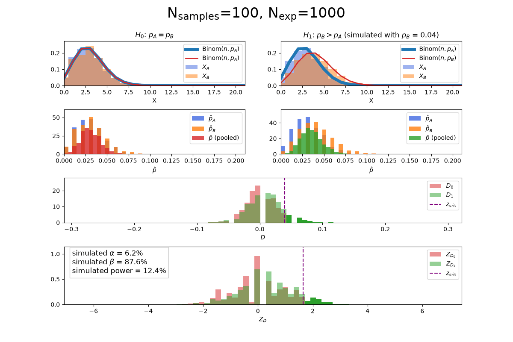
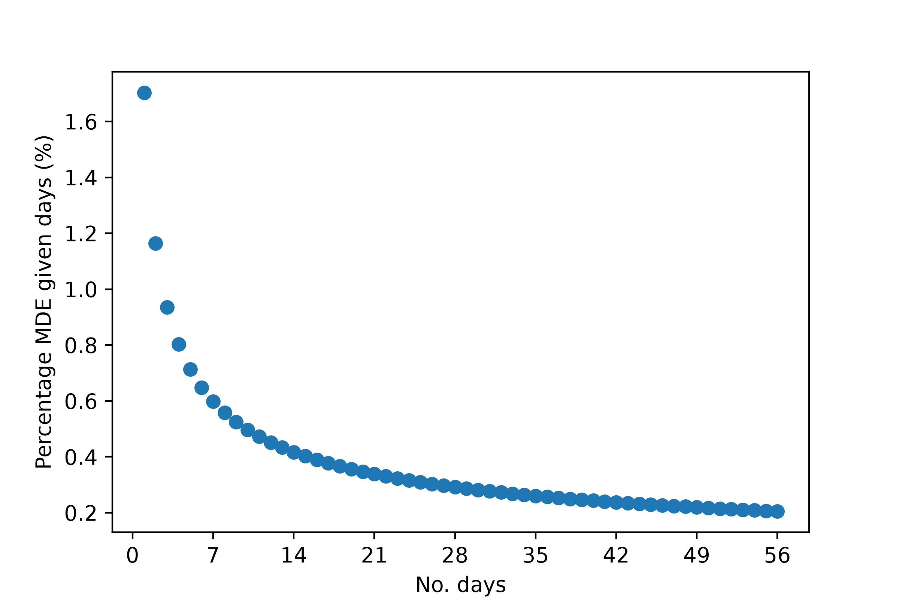
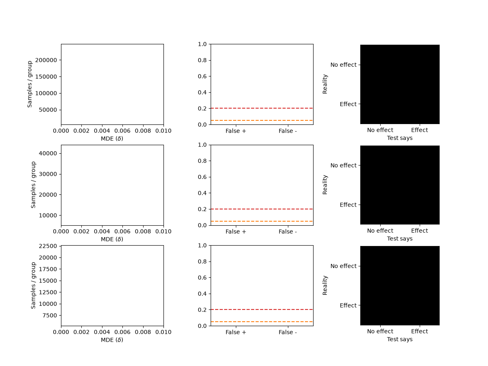

Hi there, in this post we will go through 'AB testing' or 'null hypothesis testing', that essentially wants to determine whether some change or idea performs better or at least _differently_ compared to the original.
This includes seeing whether certain features on websites increase customer churn and whether a medicine has a significant effect during a drug trial.
We will look at common factors to be aware of when conducting these kinds of experiments in business and scientific settings before ever running an analysis or before putting a data scientist to the task.
For those interested in the underlying workings of the tests, I also go through the workings of standard techniques and some more modern techniques that you can employ going into as much detail without inflating this post beyond a 60min reading time.

UNDER CONSTRUCTION UNDER CONSTRUCTION UNDER CONSTRUCTION UNDER CONSTRUCTION UNDER CONSTRUCTION UNDER CONSTRUCTION UNDER CONSTRUCTION UNDER CONSTRUCTION UNDER CONSTRUCTION UNDER CONSTRUCTION UNDER CONSTRUCTION UNDER CONSTRUCTION UNDER CONSTRUCTION UNDER CONSTRUCTION UNDER CONSTRUCTION UNDER CONSTRUCTION UNDER CONSTRUCTION UNDER CONSTRUCTION UNDER CONSTRUCTION UNDER CONSTRUCTION
---

## Resources

- ["A/B Testing Course (Full Online Course)" -- Data36 - Online Data Science Courses](https://youtu.be/qhYsZWrTiuM?list=PLHS1p0ot3SVjQg0q1eEPrmOmPUY_AT1vB) (video)
- ["Data Science Essentials – Crash Course in A/B Testing with Case Study" - freeCodeCamp.org](https://youtu.be/KZe0C0Qq4p0) (video)
- ["A/B Testing in Data Science Interviews by a Google Data Scientist" - DataInterview](https://youtu.be/DUNk4GPZ9bw) (video)
- [Null hypothesis testing - StatQuest](https://youtu.be/0oc49DyA3hU) (video)
- [p-values - StatQuest](https://youtu.be/vemZtEM63GY) (video)
- [Statistical Power - StatQuest](https://youtu.be/Rsc5znwR5FA) (video)
- [Power Analysis - StatQuest](https://www.youtube.com/watch?v=VX_M3tIyiYk) (video)
- [p-hacking - StatQuest](https://youtu.be/HDCOUXE3HMM) (video)
- [Hypothesis Testing in Statistics - Steve Brunton](https://www.youtube.com/watch?v=vVDahuv1bq8) (video)
- [P-values: misunderstood and misused](https://arxiv.org/abs/1601.06805) (arXiv article)
- [Fundamentals of p-values: Introduction](https://arxiv.org/abs/1603.03952v1) (arXiv article)
- [Post-hoc α Hypothesis Testing and the Post-hoc p-value](https://arxiv.org/abs/2312.08040) (arXiv article)
- [Null hypothesis significance tests: A mix-up of two different theories, the basis for widespread confusion and numerous misinterpretations](https://arxiv.org/abs/1402.1089) (arXiv article)
- [Statistical Inference (2nd Edition) - George Casella and Roger L. Berger](https://pages.stat.wisc.edu/~shao/stat610/Casella_Berger_Statistical_Inference.pdf) (textbook)

# Statement of the problem

A/B testing is a widespread approach to tackling decision making in scientific and industry settings. If you are unfamiliar, on the surface all that it amounts to is quantitatively asking whether Option B performs better than or is different to some option A. A typical example is something like you suspect that your website landing page isn't clear enough and lowering the fraction of visitors who buy the product. 
With a little help from AI, I've chocked up the two websites below.



The right is obviously better: it's clear what the site is for, what they're selling and more. It's so much better that it begs the question of why even do the A/B test? In this case we probably shouldn't bother. The benefit to using design B is so obviously better that we DO NOT need to run an A/B test. However, we'll use it as an example here nonetheless.

Another common example is asking whether Drug B performs better than Drug A. 



<!-- Option 1: your rawpixel image -->
<!--  -->

<!-- Option 2: two capsules -->
<!--  -->

<!-- Option 3: randomised trial diagram -->

Or whether a given car brand's self-driving car software is safer than another.

<iframe src="{{ base_path }}/files/BlogPostData/ab-testing/sticker-pile.html"
        title="Car company logos" loading="lazy" scrolling="no"
        style="width:100%; aspect-ratio:16/10; border:0; display:block; margin:1.5em 0;"></iframe>

All of these questions can be designed and analysed as an A/B test. All you need are two (or more) options you want to look at, a _measurable_ outcome, and a question of whether any difference we see between our options is real or just random.

## Table of Contents

- [Statement of the problem](#statement-of-the-problem)
        
- [Part I: Running a good experiment](#part-i-running-a-good-experiment)
    - [Intro](#intro)
    - [Designing the experiment before you collect data](#designing-the-experiment-before-you-collect-data)
        - [Primary metrics: what do you ACTUALLY want to measure?](#primary-metrics-what-do-you-actually-want-to-measure)
        - [Writing down your hypothesis, prediction and decision rule](#write-it-down-first)
        - [Errors and power](#errors-and-power)
        - [Practical questions before you start](#practical-questions-before-you-start)
        - [Ethics](#ethics)
    - [Reading the result](#reading-the-results)
        - What a p-value is (and the bajillion things it isn't)
        - Effect sizes and confidence intervals over p-values
        - Statistical vs practical significance
        - Ship, don't ship, or iterate
    - [What can go wrong](#what-can-go-wrong)
        - Peeking
        - Multiple testing
        - The winner's curse
        - When randomisation breaks
            - Sample ratio mismatch; A/A tests
            - Returning customers, novelty effects, flickering
        - Long-term effects: holdout groups and short-term metrics that mislead
        - Objective results, subjective interpretations
            - Segment analysis: "it worked on mobile users in Tasmania"
            - Simpson's paradox
            - Observer bias and cherry-picking
            - More diagnostics are better, but don't go fishing
    - [Checklist: running an experiment](#checklist-running-an-experiment)

- [Part II: How it works and other fun asides](#part-ii-how-it-works-and-other-fun-asides)
    - The causal foundation
        - Potential outcomes (Rubin): the effect we can never observe
        - Why randomisation makes the difference in means unbiased
        - SUTVA, and cluster / switchback designs when it fails
    - Basic two-group tests
        - Which test when: proportions vs means vs counts
        - z-test, t-test, chi-squared test of independence, matched pairs
        - Fisher's exact test and the lady tasting tea
        - The Neyman–Pearson lemma: why likelihood ratios are optimal
        - Deriving the sample-size / power formula
        - Power by simulation: Monte Carlo when the formula doesn't apply
    - When the CLT lets you down
        - Heavy tails and slow convergence (simulation)
        - Permutation tests: exact inference from shuffling labels
        - Bootstrap confidence intervals
        - Mann–Whitney U, and what it actually tests
    - Ratio metrics and the delta method
        - Why naive standard errors are too small
        - Deriving the delta-method variance
    - Variance reduction
        - Stratification and post-stratification
        - CUPED as control variates
    - More than two groups: one-way ANOVA and the F-statistic (brief; links to the follow-up post)
    - Peeking, formally
        - The experiment as a random walk
        - How bad is it? Simulating false-positive rates under peeking
        - A physicist's view: the look-elsewhere effect and trials factors
        - Wald's sequential probability ratio test (a WWII story)
        - Fixes: group-sequential designs (O'Brien–Fleming)
        - Fixes: always-valid inference (mSPRT, confidence sequences)
    - Multiple testing corrections: Bonferroni vs Benjamini–Hochberg
    - The winner's curse, formally
        - Selection bias in estimated effects
        - Shrinkage: James–Stein and hierarchical models to the rescue
    - Bayesian A/B testing
        - Beta-binomial posteriors and P(B > A)
        - Expected loss as a stopping rule
        - Does Bayes fix peeking? (Not really)
        - Hierarchical priors from past experiments
    - Beyond fixed experiments: multi-armed bandits
        - Explore vs exploit, and regret
        - ε-greedy, UCB and Thompson sampling
        - When to use a bandit instead of an A/B test (and when not to)
    - Case study: from A/B tests to adaptive clinical trials
        - A simulated drug trial with early stopping
        - Response-adaptive randomisation (bandits in medicine)

- Final rules of thumb

# Part I: Running a good experiment

## Intro

Suppose we've had version A of the landing page up for a month, then switch to version B for a month. Version A converted 3.6% of visitors, version B converted 4.1%. Does this mean version B wins?

Not necessarily, broadly for two reasons:

1. **Noise.** Even if the two pages were identical, two months of visitors would never convert at exactly the same rate. We need a way of asking whether the 0.5 percentage points is large enough that it's unlikely to be random chance.
2. **Confounding.** The months differ in more than just the page. Maybe B's month included Christmas, a sale, or a viral post that flooded the site with a different demographic compared to the month version A had. Any of those could produce the gap on their own.

These two problems are what an A/B test separates out:

- **The design** (randomly splitting visitors between A and B *at the same time*) mostly deals with confounding effects. Since a "coin flip" decides who sees which page, things like showing a given version over Christmas, sales and viral posts impact the results of the two versions in the same way, so on average the only systematic difference left should actually be the stuff we want to test.
- **The analysis** (e.g. a null hypothesis test) deals with noise: if the pages truly performed the same, how often would we see a gap at least this large?

These are two very different effects with their own limitations. "A/B testing" is often used to mean the statistical test, but the randomisation is getting us most of the way and no amount of clever analysis can fix a badly randomised experiment; the test is just one of several ways to analyse the data after performing the experiment (I'll try and cover Bayesian and sequential alternatives in Part II).

## Designing the experiment before you collect data

### Primary metrics: what do you ACTUALLY want to measure?

The most seemingly obvious thing that you have to do before running an A/B experiment to find which option is better is to actually ask what is "better"? 

For scientific purposes, “better” usually falls out of the question itself. “Does dark matter exist?” becomes “is the fraction of events attributed to a dark matter signal greater than zero, beyond what background fluctuations could produce?” “Is waveform model X better than Y?” becomes “does X fit the data significantly better than Y?”

For industrial settings "better" can be more subjective. We need to pick one or at most two "**primary metrics**" which are a single number that define "better" for a given experiment. Using website design as an example this could be:
- Higher click through rate from the landing page to the item page
- Higher click through rate from the item page to a specific item listing
- Higher number of people that visit a specific listing and then put the item into their cart
- Higher number of people that visit a specific listing and then actually buy the product
- Spending more time on the listing page
- Scroll more on the website

Some of these by their very nature are not good metrics. For example, "spending more time on the listing page" or "scroll more on the website" may not mean a "better" website, but rather a confused user that is trying to figure out what's going on! Click-through rates are less ambiguous but don't necessarily translate into sales. Sales is essentially what you _always_ want, however, the number of sales is likely to be significantly lower than the number of people just _visiting_ your website. Especially for smaller business, the rate at which people visit the website and buy an item will likely be so low that despite the metric being "good" we wouldn't be _sensitive_ to it. 

**Metric sensitivity** is whether given the amount of data we expect to collect in a given experiment and the expected number "hit rate" of the two options (fraction of people clicking through or fraction of people buying dog food), would we be able to get a significant enough difference to conclude that one option is better/different to the other? 

For example let's say over the course of a few months, you measure the fraction of people that once on the landing page and then actually buy a product on average 3%, but this number fluctuates by up to 0.4 percentage points (that is between 2.6% and 3.4%). Then, you want to perform an A/B test experiment for a single month for a new landing page, and you measure that the rate for the original page in this month is 2.8% and the rate for the new one is 3.1%. Do you think this would actually mean the new page is better? Or just that the number fluctuates enough that you can't really tell the difference based on the data from the experiment? We will later see that for common meaures of significance, that the required number of visitors would be around 50,000!

Another thing that we may want to keep in mind are what are called **guardrail metrics**. These are numbers that you don't want to *worsen* as part of your test. Switching to vaccine trials, your primary metric could be the infection rate (lower=better), and of course you want that number to go down. However, you **do not** want the number of people that experience adverse reactions to the vaccine to go up. Or in machine learning emotion classification tasks, where you use a machine learning model to predict the emotion showing in an image, a primary metric might be "correctly identifies the emotion on the face". *However*, you likely wouldn't want the rate at confidently classifying the wrong emotion to rise as well (e.g. someone that is very angry is actually classified as calm and happy...). On the landing page, a guardrail might be the page load time, refund rate, or newsletter unsubscribes. A "flashier" page that sells slightly more, but doubles the return rate, ain't the better option.

Another thing that we need to keep in mind is that people can be weird. That is, sometimes we will encounter outliers that would otherwise skew our results. Suppose instead of purchase rate we use *revenue per visitor*. Most visitors spend \$0, most buyers spend \$40–60 on a bag of dog food… and then one breeder buys \$4,000 worth for their kennel. If they happen to land in group B, B "wins", and the result doesn't really reflect the actual page but that breeder.

Metrics like revenue are **heavy-tailed**: a handful of extreme values can dominate the average, so the mean can vary a lot and then needs more data to conclusively pin down. Some common fixes are:
- **Cap (winsorise)** extreme values, e.g. treat any order above the 99th percentile as if it were the 99th percentile.
- **Use a binary metric** alongside it ("did they buy at all?"), which a single outlier can't move much.
- **Use methods that don't lean on the mean**, like rank-based tests or the bootstrap (Part II).

Whatever you choose, we need to decide on it *before* looking at the data. Deciding to drop outliers after seeing which group they landed in is exactly what can lead to **cherry-picking**.[^cherrypicking]

[^cherrypicking]: The term "cherry-picking" literally refers to the practice of fruit harvesters that throw away the "bad cherries", only selling the good ones. Referring to how an analyst can look at their data and decide that some data is "bad" and throw it away. 

A subtler trap is the **unit** of the metric. Click-through rate can be computed per *page view* (total clicks ÷ total page views) or per *user* (did each user click at least once?). If we randomise users but compute the metric per page view, one visitor with 100 page views counts 100 times, and their page views aren't independent: they're all the same person making similar choices. Treating them as independent makes our uncertainty look smaller than it really is, so we'll "discover" significant differences more often than we should. The fix (the *delta method*) is in Part II; for now the rule of thumb is: **analyse at the same level you randomise**, or use a method that accounts for it.

So we have a single primary metric that unambiguously means "better", a few guardrails that we don't want to get worse, and a check that we'll actually have enough data to see a difference. With these, we can now write down exactly what we expect to happen.

### Write it down first

Before collecting any data, write down what you're testing, what you expect, and what you'll **do** with a given outcome. 
This is called **pre-registration**, and its point is that you can’t quietly move the goalposts once you’ve seen the results. Particle physics (and many other domains, but I was trained as a particle physicist) takes a related idea further with blind analysis: the signal region is hidden, or the result is shifted by an unknown offset, while every analysis choice is made. You only “unblind” once the method is frozen, so the result can’t be nudged towards what you want it to be.

| | Landing page | Vaccine efficacy | Drug dosage |
|---|---|---|---|
| **Question** | Does the clearer page sell more? | Does the vaccine reduce infection? | Does recovery improve as the dose increases? |
| **Null hypothesis** | Purchase rate is the same | Infection rate is the same as placebo | Dose has no effect: recovery is flat from placebo upward (slope β₁ = 0) |
| **Prediction** | B ≥ A by at least 0.3 pp | ≥ 50% fewer infections | Recovery rises with dose (β₁ > 0) |
| **Primary metric** | Purchase rate per visitor | Infection rate over 6 months | Recovery rate at 4 weeks, regressed on dose (0, 10, 20, 40 mg) |
| **Guardrails** | Refund rate, load time | Serious adverse events | Side-effect rate at each dose |
| **Sample size / duration** | Decided by a power calculation | Decided by a power calculation | Decided by a power calculation |
| **Decision rule** | Ship B if significant at 5% and guardrails hold | Proceed if efficacy is significant and safety acceptable | Reject β₁ = 0 at 5%, then pick the lowest dose with acceptable side effects |

> Note: Vaccine and dosage thresholds are illustrative; real trials and the numbers they use are dictated by regulators. Please do not actually use what I'm using as fact *😂*

### Errors and power
<!-- - False positive / false negative (TABLE)
- Significance vs power; 80% vs 99% (a 20% vs 1% miss rate)
- Minimum detectable effect
- Worked example: "you need ~31k users per arm" -->

Here we are going to run through the key numbers that anyone running one of these tests or experiments should be familiar with (and may have used a couple times already in the post): **false positive and negatives**, **significance**, **power**, and **minimum detectable effect**.

For an A/B experiment, sometimes the measured outcome isn't the same as the 'correct' outcome. 
Any test/experiment can reach the wrong conclusion, and there are two ways to do it. 
You may remember these from the COVID tests: a *false positive* says you're infected when you're not; a *false negative* says you're clear when you're not. 
An A/B test makes the same kinds of mistakes, but about the **whole experiment** rather than one person:

| | **B really is no different** (null true) | **B really is different** (null false) |
|---|---|---|
| **Test says "B is different"** | ❌ False positive (Type I error) | ✅ Correct detection |
| **Test says "no difference"** | ✅ Correct | ❌ False negative (Type II error) |

Note that individual participants "going the wrong way" (an unvaccinated person who never gets infected, a visitor to the clear page who doesn't buy) aren't errors in this sense. That's just the person-to-person variation, the *noise*, that the test has to see through. The errors are about the conclusion we draw from all of them together.

The two error rates get names:
- **Significance level (usually denoted $$\alpha$$)**: the false positive, or Type I error, rate we're willing to accept, typically 5%.
- **Power $$(1-\beta)$$** : the probability of catching a real effect of a given size, typically 80%; i.e. we accept missing a real effect 20% of the time. With **$$\beta$$** being the false negative or Type II error rate/probability

For the signficance level, another way or saying this is if B truly does nothing in comparison to A (i.e. they're equivalent), then at $$\alpha$$ = 5% roughly 1 in 20 experiments will still conclude that they are different. We could run 20 tests and expect one ‘discovery’. (later we'll talk about ways to combat this if it is an issue). 
In particle physics, a new particle is only claimed at "$$5\sigma$$", a p-value of about $$3\times10^{-7}$$. In other words, if there were no new particle, random noise fluctuations would only produce a result that extreme about once in ***3.5 million experiments***. 
Reaching that bar takes enormous amounts of data, which a typical business/single experiment neither has nor needs, so we'll mostly stick with 1 in 20 ($$\alpha=0.05$$), or 1 in 100 ($$\alpha=0.01$$) if we want to be *really* sure.

Power is then the rate at which we *would* see a difference if one really exists. 
With 80% power ($$(1-\beta)=0.8$$), if B truly beats A by that amount and we ran the experiment 10 times, on average 8 runs would detect it and 20% of the time, or twice, would wrongly conclude there's no difference ($$\beta = 0.2$$). Below is a gif that demonstrates these aspects as areas under distributions. 

The first row shows what we're actually measuring over a 1000 simulated experiments, where each experiment is a test that a company or scientist would do using $$N_\text{samples}$$. $$X$$ measures the number of conversions or 'success' for experiments [^effect].
The second row then shows the estimated converion rates (e.g. fraction of people that buy a product given that they were on the landing page for landing page design A or B) or simply the rate of success (fraction of $$N_\text{samples}$$ where an effect was seen) as well as pooled estimates wheree you presume the null hypothesis (that the conversion rates are the same).

[^effect]: The definition of success can change depending on perspective, it just means a given sample sees an effect.

  

The third row is then the differences between the estimated effects per experiment: if in a given experiment/test we measure the conversion for landing page A to be $$p_A=0.03$$ and the conversion rate for landing page B to be $$p_B=0.035$$, then the difference would be $$D=p_B-p_A = 0.005$$. And then the final row is just the difference distribution (row 3) but standardised. The ***significance is*** the fraction of area outside the critical values we've set for the experiment (in this case $$\alpha=0.05$$ translates into a standardised value of $$\sim\pm 1.96$$) and the ***power is** the fraction of area in the green distribution outside those bounds.

We could also do what's called a **on-sided test** where all you're interested in is whether the conversion rate is higher, e.g. you will only ship a feature if it performs better, and if it performs the same or worse then you don't care, you won't ship it either way. Thee the power and signifiance are the same, except we're only concerned with the areas *above* (the positions of which slightly change between the one-sided and two-sided tests).

  

Another question we might ask ourselves is if the true effect is *smaller* than we planned for, our the power drops, then we need to decide on a **minimum detectable effect**.

The minimum detectable effect is relatively self-descriptive, it's the smallest effect that we'd decide is significant given our choices on power and significance (e.g. if the number of sales go up by X% amount then the change was for the better, or if the rate of infection went down by Y% then we can say that 'this vaccine' is better).

The catch is that noise only shrinks, and thus the required size of the effect decreases, slowly with more data. 
For a 3% conversion rate, the random wobble in the *difference* between two groups could start at ~0.76 and then:

| Visitors per version | Typical variation in the difference |
|---|---|
| 1,000 | ±0.76 pp |
| 10,000 | ±0.24 pp |
| 50,000 | ±0.11 pp |

It typically shrinks like $$1/\sqrt{n}$$. Doubling the amount of data you have decreases the measurement noise by a factor of 2, and increasing the amount of data by 10 decreases the amount of noise only by about a factor of 3...  So small effects need *a lot* of data. For example with the standard power and significance numbers used above and the "typical variation" table:

| MDE (from a 3% base rate) | Visitors needed per version |
|---|---|
| +0.3 pp (3.0% → 3.3%) | ~53,000 |
| +0.6 pp (3.0% → 3.6%) | ~14,000 |
| +0.9 pp (3.0% → 3.9%) | ~6,500 |

Halving the effect you want to detect roughly *quadruples* the sample you need (inverse of the decrease in the size of the noise). A plot showing how you probe more minute differences in effects (MDE) as a function of days presuming 2,000 views per day with $$alpha=0.05$$ (significance) and power of 80%. You can see that early on there is a large benefit to increasing the time period one or two days, but then later on the benfits significantly decrease.

  

The standard formulae to decide how much data is required for a given MDE (denoted $$\delta$$ in the formula) are:

$$\begin{align}
N \approx \frac{(\sigma^2_\text{A} + \sigma^2_\text{B})(z_{1-\alpha/2} + z_{1-\beta})^2}{\delta_\text{MDE}^2}
\end{align}$$

with $$\sigma^2_\text{A}$$ and $$\sigma^2_\text{B}$$ being the noise in the measurements squared or the *variance*. 

If you're specifically interested in conversion-rates for option A ($$p_A$$) and for option B ($$p_B$$) then we can use a more specific formula where $$\delta$$ is now the difference between the rates $$\delta_\text{MDE}=p_B - p_A$$ and the two variances become a function of $$p_A$$ and $$p_B$$:

$$\begin{align}
N \approx \frac{(z_{1-\alpha/2} + z_{1-\beta})^2 \,\big[p_A(1-p_A) + p_B(1-p_B)\big]}{(p_B - p_A)^2}
\end{align}$$

where $$z_{1-\alpha/2} \approx 1.96$$ for $$\alpha = 0.05$$ and $$z_{1-\beta} \approx 0.84$$ for 80% power. A demonstration of the kind of effects one can see if they don't properly increase the number of samples can be seen in the gif below.

  

With three examples over three hundred simulated experiments: a quadratic increase in the number of samples (correct), a linear increase (e.g. one might assume half the change requires double the samples), or a constant amount (e.g. say someone says that they had more power than they needed in their last tests, surely the same amount will do for a little bit smaller of an MDE...nope). The left column is the number of samples used for experiments vs the MDE (the bottom two rows highlighted red because with our choice of power and significance, they are wrong).
The middle column shows the false positive and false negative rates.
And the last column shows the confusion tables for the experiments.

There are two things to note that can both be seen in the centre column. As your worsen the number of samples used: 1. the false positive rate doesn't go up and 2. the false negative rate *does* go up. 
Throwing away all the math really quickly, if we just have less information, then the relative noise to the changes will *increase*. 
Hence, you will be more likely to say that there is no significant difference most of the time, even when there is one (increase in false negative rate). But because you're less likely to say anything at all, you're also not going to say that there is a difference when there isn't one (no impact on false positives).

This made me wonder about what would lead to an increase in false positives but keep the false negative rate the same, and that basically falls under problems with peaking and multiple testing that I will go through in [What can go wrong](#what-can-go-wrong).

### Practical questions before you start

Before one even starts an AB test, I think that there a few questions one should ask particularly for business with relatively low traffic or budgets.

**Is the dataset big enough? Is the timeframe long enough?** 

**Will it take too long? Early predictors / surrogate metrics**

**One change or many: buttons vs vibes**

**Randomisation unit: user vs session vs page view**

**Interference: when treatment leaks into control (social networks, marketplaces)**

**A/B/C/.../H tests**

### Ethics

## Reading the results

## What can go wrong

## Checklist: running an experiment

# Part II: How it works and other fun asides

## Test Statistic rules

$$X_A \sim \text{Binom}(n, p_A), X_B \sim \text{Binom}(n, p_B)$$

$$\hat{p}_A = X_A/n, \hat{p}_B = X_B/n$$

$$D = \hat{p}_B - \hat{p}_A$$

$$\mathbb{E}[\hat{p}] = p, \mathbb{V}[\hat{p}] = \frac{p(1-p)}{n}$$

$$\mathbb{E}[D] = p_B-p_A \equiv \delta, \mathbb{V}[D] = \frac{p_A(1-p_A)}{n} + \frac{p_B(1-p_B)}{n} = \sigma_1^2$$

By CLT: $$D \sim \mathcal{N}(\delta, \sigma_1^2)$$

---

Null Hypothesis ($$H_0$$): $$p=p_A=p_B$$

pooled estimates: $$\bar{p} = \frac{p_A+p_B}{2}$$

null-hypothesis standard dev: $$\sigma_0 = \sqrt{\frac{2\bar{p}(1-\bar{p})}{n}}$$

null-hypothesis z-score: $$z_0 = \frac{D}{\sigma_0}$$

rejection cut-off: $$c = z_c \sigma_0$$

Power: $$P(D>c) + P(D<-c)$$. From step 1 to step 2 we assume $\sigma_1$ is correct, then the left side of the equality follows a standard normal.

$$\begin{align}
P(D>c) &= P(\frac{D-\delta}{\sigma_1}>\frac{c-\delta}{\sigma_1})\\
&= 1- \Phi(\frac{c-\delta}{\sigma_1})\\
&= \Phi(\frac{\delta - c}{\sigma_1}) \\
&= \Phi(\frac{\delta - z_c \sigma_0}{\sigma_1})
\end{align}$$

Using $$\sigma_1=s_1/\sqrt{n}$$ and $$\sigma_0=s_0/\sqrt{n}$$

$$\begin{align}
z_{1-\beta} &= \frac{\delta - z_c s_1/\sqrt{n}}{s_0/\sqrt{n}} \\
z_{1-\beta} s_1 &= \delta \sqrt{n} - z_c s_0 \\
n &= \left(\frac{z_{1-\beta} s_1 + z_c s_0}{\delta} \right)^2
\end{align}$$

---

## AI Statement

I've not used AI for any of the body text or code writing pertaining to actual A/B testing, but at times have used it to 
- chock up some quick website designs
- fact checker/checking for inconcsistencies
- got it to help me with animating the confusion matrix in [Parti I: Errors and Power](#errors-and-power)

# Footnotes
